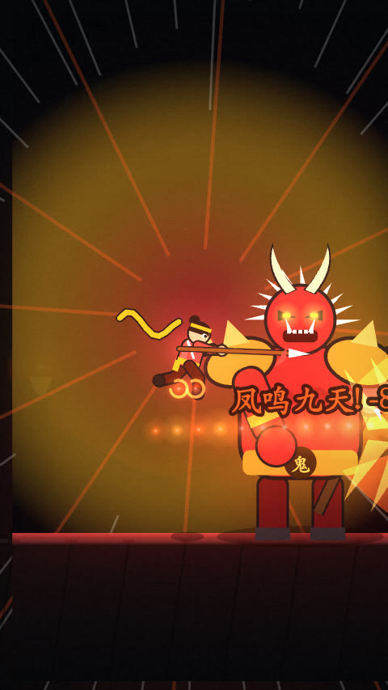
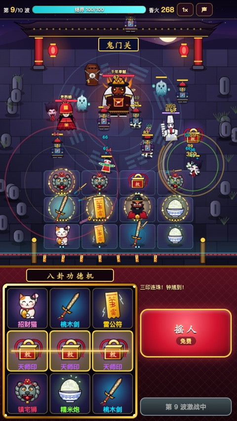

# 回声游戏厅 · 每天一个小游戏

**这里的 15 个游戏全部由 Claude Fable 5.2 制作。** 人只负责出题和提意见（“做个搓澡的”“太简单了”“导航不够明显”），代码、玩法、画面、音效、配音台词和首页都是 Fable 在 Claude Code 里写出来、自己截图检查、再一轮轮改出来的。

**在线玩：<https://zhgarylu.github.io/everyday-game/>**

打开就能玩，不用安装、不用登录，电脑、平板、手机的浏览器都支持。选题走的是接地气的生活梗：送外卖、搓澡、摸鱼、挤地铁、相亲角、夜市套圈、芯片商战、广州漂移、摇功德机请法器……每个游戏一局两到五分钟，操作方式各不相同。

## Fable 做了什么

- **全部代码**：每个游戏一个 `index.html` 加一两个 JS 文件，没有构建步骤，没有游戏引擎，只用了 three.js。
- **全部画面**：模型是用基础几何体在代码里拼的（天师摇人和十形拳是 2D，符号、人物和妖怪用路径一笔笔画出来），材质、天空、路面积水反射、后期调色都是着色器算出来的，仓库里没有模型文件；除了清潮，也没有图片素材。
- **全部音效**：用 Web Audio 实时合成，没有音效文件。
- **配音**：台词和语气指令由 Fable 写，再调用语音合成服务生成 mp3。
- **玩法和数值**：选题清单、规则、难度曲线都是 Fable 提方案，人来挑和反馈。
- **自测**：每个游戏留了调试入口，Fable 用它推进时间、让电脑代打、截图看效果，再回头改。

不是 Fable 做的只有两样：清潮里的角色图是另行生成后接入的，语音的声音本身来自火山引擎语音合成。

## 游戏列表

| | 游戏 | 一句话 | 怎么玩 |
| --- | --- | --- | --- |
|  | **第 15 期 · 十形拳**<br>[在线玩](https://zhgarylu.github.io/everyday-game/wushu/) | 横版闯关，十种拳路一路打穿 | A D 移动，W 或 K 跳（可二段），J 三段连招，L 或 Shift 闪身，空格放奥义，1–9、0 或 Q E 切换拳路，顶开带字的秘籍箱也会换形态。十种拳路各有三段招式和一个全屏奥义（金龙、万剑、八卦阵、金刚神掌、紫电九连斩、凤凰枪、冰河碎星、次元斩、破空拳），打飞的妖怪会撞翻身后一串。六重关卡从青竹镇打到霓虹夜市，最后在擂台上打倒赤鬼王。点子和初版来自玩家带来的一个单文件游戏，Fable 把角色、敌人和关卡全部换成原创设计，重画了画面、重做了招式。横屏，手机有触屏按键 |
|  | **第 14 期 · 天师摇人**<br>[在线玩](https://zhgarylu.github.io/everyday-game/merit/) | 老虎机加塔防：摇出法器，守住结界 | 点按钮或按空格摇 3×3 的功德机，20 香火一次，横竖斜 8 条线里三个连上就请出一件法器，天师印是百搭。妖怪从鬼门关往下闯，共 10 波，有跳僵、毛僵、纸人、飞头蛮、铁棺尸、白无常、鬼新娘和千年旱魃。把法器拖到同类身上炼化叠层，叠 3 层渡劫觉醒；每波打完三选一件法宝改转轴概率；三个天师印连线请出钟馗清场。这一期是 2D 画面，点子和初版来自玩家带来的一个单文件游戏，Fable 重画了全部素材并重做了数值。横竖屏都能玩 |
|  | **第 13 期 · 广州漂移**<br>[在线玩](https://zhgarylu.github.io/everyday-game/gz/) | 雨夜骑电鸡在广州甩尾送外卖 | 自动加速，A D 转向，按住空格漂移、松开喷射，S 刹车；手机左半屏滑动转向，右下按住漂移。沿环线穿过光门取餐、送达，每过一道门加时间，漂移攒小费，撞墙撞车会洒汤扣钱。路上有猎德大桥、珠江新城、中山纪念堂、海珠桥、骑楼老街、城中村和广州塔。路面积水是真实镜面反射，配音是粤语。横竖屏都能玩 |
|  | **第 12 期 · 皮衣老黄**<br>[在线玩](https://zhgarylu.github.io/everyday-game/chip/) | 回合制策略：创始人回来救场，12 个季度把市值做回第一 | 点按钮搞研发、扩产、挖人，点地图上挨着自己的格子进攻或加固。研发攒满开发布会，点一下定参数吹多大。每季度结算收入，对手也会来抢地盘，还有矿潮、出口限制等突发事件要二选一。人物和公司纯属虚构 |
|  | **第 11 期 · 骑手**<br>[在线玩](https://zhgarylu.github.io/everyday-game/rider/) | 骑电动车在老城送外卖，从上午跑到深夜 | W 加速、S 刹车、A D 转向，Y 接单。跟着路面箭头走，停进光圈自动取餐送餐。平台给每单一个时限，你越准时它给得越紧；有昼夜、五种天气、车流和红绿灯，还有交警查车、学校限速抓拍、过马路的行人、施工占道、路边突然开的车门和高峰堵车；骑手有心情，会接到妈妈和顾客的电话。横竖屏都能玩 |
|  | **第 10 期 · 怒砸办公室**<br>[在线玩](https://zhgarylu.github.io/everyday-game/smash/) | 显示器、奖杯、打卡机、老板椅、保险柜，全部砸成渣 | 点哪砸哪，按住划过去一路砸。连砸涨倍数，怒气满了暴走，保安到之前尽量砸 |
|  | **第 9 期 · 相亲角速配**<br>[在线玩](https://zhgarylu.github.io/everyday-game/match/) | 大妈报条件，你来判断候选人合不合适 | 全都符合往右划，有一条不符合往左划。条件越加越多、越来越绕 |
|  | **第 8 期 · 夜市套圈**<br>[在线玩](https://zhgarylu.github.io/everyday-game/ring/) | 10 块钱 12 个圈，圈住什么拿什么 | 按住往上拖瞄准，松手扔圈。越远越值钱，大鹅会走，老板会“脚滑” |
|  | **第 7 期 · 捏泡泡纸**<br>[在线玩](https://zhgarylu.github.io/everyday-game/pop/) | 啪啪啪，一张接一张 | 按住在泡泡上划。金泡加时间，连环泡炸一片，臭屁泡别碰 |
|  | **第 6 期 · 挤地铁**<br>[在线玩](https://zhgarylu.github.io/everyday-game/metro/) | 早高峰，把人塞进车厢 | 按住拖动推手往车门里推。要下车的先放出来，关门前塞够人数。途经 33 个出名拥挤的地铁站 |
|  | **第 5 期 · 摸鱼大师**<br>[在线玩](https://zhgarylu.github.io/everyday-game/moyu/) | 按住摸鱼，松手装作在工作 | 只有一个操作：按住和松开。老板会回头、摄像头会亮红灯、HR 会路过，十八种摸鱼方式随机出现 |
|  | **第 4 期 · 搓澡大师**<br>[在线玩](https://zhgarylu.github.io/everyday-game/scrub/) | 把顾客背上的泥搓成一根根泥条 | 按住在背上来回搓。躲开红色痛点，老泥多搓几遍，限时搓干净拿小费 |
|  | **第 3 期 · 吃啥拉啥**<br>[在线玩](https://zhgarylu.github.io/everyday-game/eat/) | 吃什么就拉什么，砸翻身后的馋嘴怪 | 左右拖动小兽去吃食物：辣椒喷火、冰淇淋冰冻、西瓜拉出巨无霸。连吃三个一样的超级加倍 |
|  | **第 2 期 · 清潮**<br>[在线玩](https://zhgarylu.github.io/everyday-game/tide/) | 小队射击，清掉涌来的怪潮 | 左右拖动小队，自动开火。左边打冰块拿队员、武器和巨型帮手，右边清怪 |
|  | **第 1 期 · 晶塔守卫**<br>[在线玩](https://zhgarylu.github.io/everyday-game/td/) | 塔防，大招华丽 | 沿路摆九种防御塔，攒能量放六个大招。四张地图逐关解锁。横屏，键盘鼠标更顺手 |

## 首页

首页按“每天一个小游戏”设计：

- **今日游戏**：当天上线的新游戏；没有新游戏的日子，在已上线的里面按天轮换。
- **上新日历**：一周七天，玩过当天的游戏就算打卡。
- **全部游戏**：可以搜索、按标签筛选、按上线时间或时长排序。
- **我的记录**：连续打卡天数、玩过几个、上次玩的是哪个。记录存在浏览器本地，不需要登录。

## 通用操作

- 所有游戏都能用鼠标或手指玩，没有需要键盘才能进行的操作（晶塔守卫用键盘更方便）。
- 声音要先点一下画面才会响，这是浏览器的限制。按 `M` 静音。
- 每个游戏的标题和结算界面左上角有“‹ 游戏厅”，可以回首页。

## 本地运行

```bash
git clone https://github.com/zhgarylu/everyday-game.git
cd everyday-game
python3 -m http.server 8123
```

然后打开 <http://localhost:8123/>。不需要安装任何依赖，用到的 three.js 文件已经放在 `vendor/three/` 里。任何能托管静态文件的服务都可以，直接双击打开 `index.html` 不行（浏览器不允许本地文件加载模块）。

## 目录结构

```
index.html  hub.js   首页
games.js             游戏清单：期数、上线日期、入口、标签、时长
covers/              封面图（实机截图）
td/ tide/ eat/ ...   每个游戏一个目录：index.html + game.js，语音在 voice/（骑手还有 voice_sys/、voice_npc/）
rider/               骑手：world.js 城区和渲染、sim.js 平台模拟和心情、traffic.js 车流、hazards.js 交警行人等路况、game.js 骑行
tide/assets/         清潮的角色和图标素材，ASSET_SPEC.md 是素材规格说明
vendor/three/        three.js 0.170 中用到的文件
tools/gen_voice.py   预生成语音的脚本
```

## 加一个新游戏

1. 新建一个目录，放 `index.html` 和 `game.js`。
2. 在 `games.js` 里加一条：期数、上线日期、入口、标签、时长，以及怎么读它的最高分。
3. 封面图放进 `covers/`。
4. 开局时往 `localStorage` 的 `echo_hub` 里记一次打卡，标题界面加一个回首页的链接（照着任意一个现有游戏抄即可）。

首页的今日游戏、日历、列表和筛选标签会自动更新。

## 技术说明

- 渲染：three.js 0.170，后期用了泛光；晶塔守卫和骑手另有自己写的调色、环境光遮蔽和景深；广州漂移的湿地路面把场景镜像再渲染一遍做反射，帧率不够时自动降分辨率。模型是用基础几何体在代码里拼出来的，没有外部模型文件。
- 音效：全部用 Web Audio 实时合成，没有音效文件。
- 语音：各游戏 `voice/` 下的 mp3 是预先生成的。清潮之后的游戏用的是广西口音，晶塔守卫是陕西话，广州漂移是粤语，天师摇人也是广西口音；骑手里的平台播报、妈妈、顾客和交警是另一个能调语气的声音。生成脚本依赖本机的合成工具和密钥，仓库里不包含。
- 每个游戏都留了一个调试入口（如 `window.__smash`），可以推进时间、让电脑代打，用来做自动测试。

## 许可和素材

- three.js 按 MIT 协议使用，许可见 `vendor/three/LICENSE`。
- 清潮的角色图在 `tide/assets/`，是另行生成后接入的。
- 各游戏 `voice*/` 下的 mp3 由火山引擎语音合成生成。
